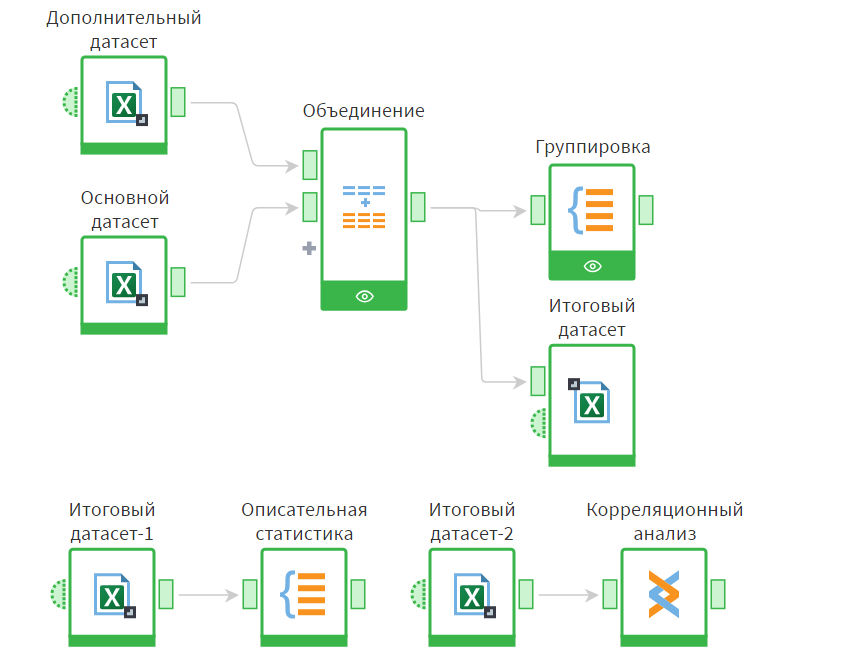
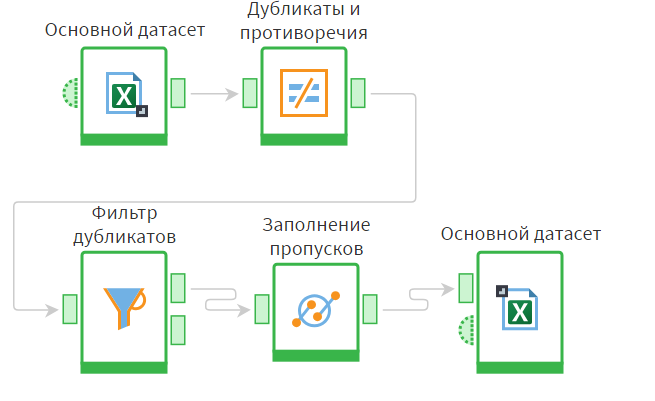
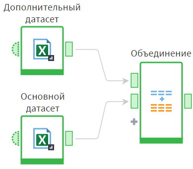
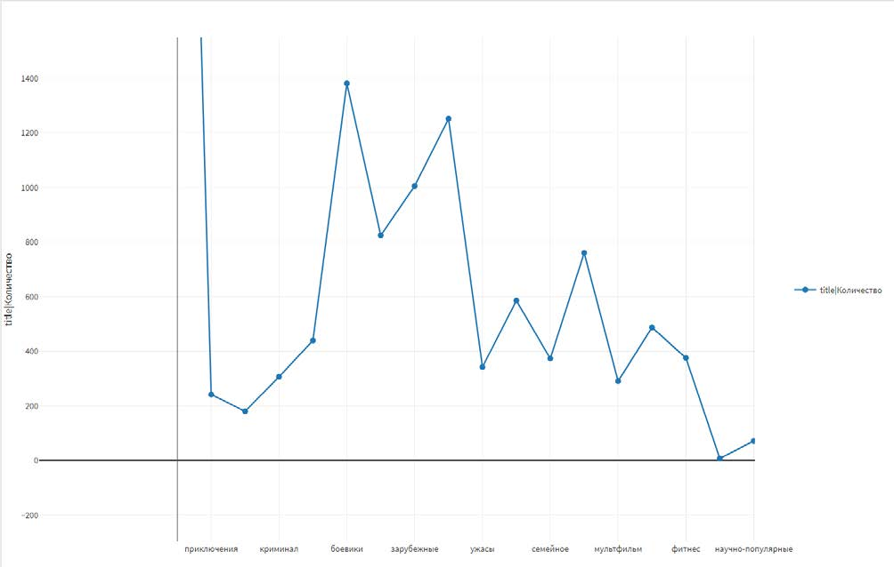

# Популярность фильмов по жанрам: анализ данных онлайн-кинотеатра в Loginom

Курсовая работа: сценарий обработки и анализа данных о просмотрах фильмов
в онлайн-кинотеатре Kion, полностью построенный в low-code платформе **Loginom**.

**Вопрос исследования:** зависит ли популярность фильма от его жанра и на какие жанры
сервису стоит делать упор.

## Данные

[KION dataset](https://www.kaggle.com/datasets/asenin/kion-dataset) (Kaggle) — взаимодействия
пользователей с контентом за период с 13 марта 2021 года по 22 августа 2022 года и
справочник фильмов: название, оригинальное название, жанры, страна, год.

## Сценарий в Loginom

1. **Импорт** — загрузка двух таблиц из Excel, настройка типов полей.
2. **Очистка** — блоки «Дубликаты и противоречия» и «Фильтр дубликатов»,
   заполнение пропусков медианой, экспорт очищенной таблицы.
3. **Интеграция** — объединение основного и дополнительного датасетов
   по полям title, genres, title_orig, countries, year.
4. **Агрегирование** — блок «Группировка»: число фильмов и уникальных
   названий по каждому жанру, итоговая сводная таблица.
5. **Описательная статистика** — минимум, максимум, среднее, медиана, мода,
   стандартное отклонение.
6. **Визуализация** — динамика количества просмотров по жанрам.
7. **Корреляционный анализ** — коэффициент Пирсона.

| Очистка данных | Объединение источников |
| --- | --- |
|  |  |

## Результаты

- Самый популярный жанр — **драма**. Основная часть просмотров приходится на четыре
  категории: драмы, зарубежное, русское кино и боевики. Именно на них сервису
  стоит делать упор в контентной стратегии.
- Разброс количества просмотров между жанрами очень большой.
- Коэффициент корреляции Пирсона между жанром и количеством фильмов — **−0,16**:
  связь есть, но слабая.

## Ограничения и что можно улучшить

- У многих фильмов несколько жанров, а в анализе учитывался один. Следующий шаг —
  разбить список жанров и считать каждый жанр фильма отдельно.
- Пирсон предназначен для числовых признаков. Для связи «категория — число» корректнее
  сравнить жанры по медианам просмотров или проверить различия критерием Краскела–Уоллиса.
- Данные одной платформы и за ограниченный период.

## Стек

Loginom (импорт, очистка, соединение, группировка, корреляционный анализ, визуализация) · Excel
